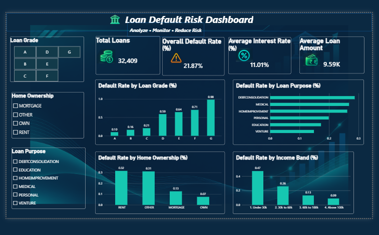

# Loan Default Risk Analysis

## Problem statement
A lender wants to reduce losses from loan defaults. This project analyzes borrower and loan data to find which customer profiles are most likely to default, and recommends how the lender can improve its approval decisions.

## Business Questions
1. What is the overall default rate?
2. How does the default rate change across loan grades?
3. Which loan purposes and home ownership types carry the most risk?
4. How do income and age relate to default?
5. How do interest rate and loan size relative to income relate to default?
6. Which borrower segments are the highest risk, and what should the lender do about them?

## Dataset
- Source: Credit Risk Dataset (Kaggle)
- Size after cleaning: 32,409 loans, 12 columns
- Target: `loan_status` (1 = default, 0 = no default)

## Tools
Python (pandas, matplotlib, seaborn), MySQL Workbench (SQL), Power BI

## Project workflow
1. **Data inspection and cleaning** (`notebooks/01_data_cleaning.ipynb`): removed duplicates and impossible values, filled missing employment length and interest rate with the median.
2. **Exploratory analysis** (`notebooks/02_eda.ipynb`): charts and correlation analysis.
3. **SQL analysis** (`sql/loan_queries.sql`): 7 queries using GROUP BY, CASE WHEN, HAVING and a subquery.
4. **Dashboard** (`dashboard/loan_default_dashboard.pbix`): KPI cards, charts and slicers.

## Dashboard

## Key insights
- 21.87% of borrowers defaulted (7,088 of 32,409 loans).
- Default rate rises from 9.96% (grade A) to 98.44% (grade G), with the biggest jump between grades C and D.
- Income is a stronger signal than age: borrowers under 30k default at 47.20%, against 8.95% above 100k.
- Renters default at 31.61%, against 7.49% for owners, and 92.33% when the loan is 30% or more of income.
- A previous default nearly doubles the risk (37.86% vs 18.44%).
- Loan-to-income ratio and interest rate show the strongest link with default.

## Recommendations
- Tighten approval rules for grades D to G.
- Cap loan amount relative to income, especially for renters.
- Review applicants with a previous default or low income.
- Do not use age alone in approval decisions.

## Limitations
This is an analysis of historical data. Correlation does not prove cause, and no predictive model was built.

## How to run
1. Place `credit_risk_dataset.csv` in `data/raw/`.
2. Run the notebooks in order.
3. Run the SQL queries on the cleaned data in MySQL.
4. Open the `.pbix` file in Power BI Desktop.

